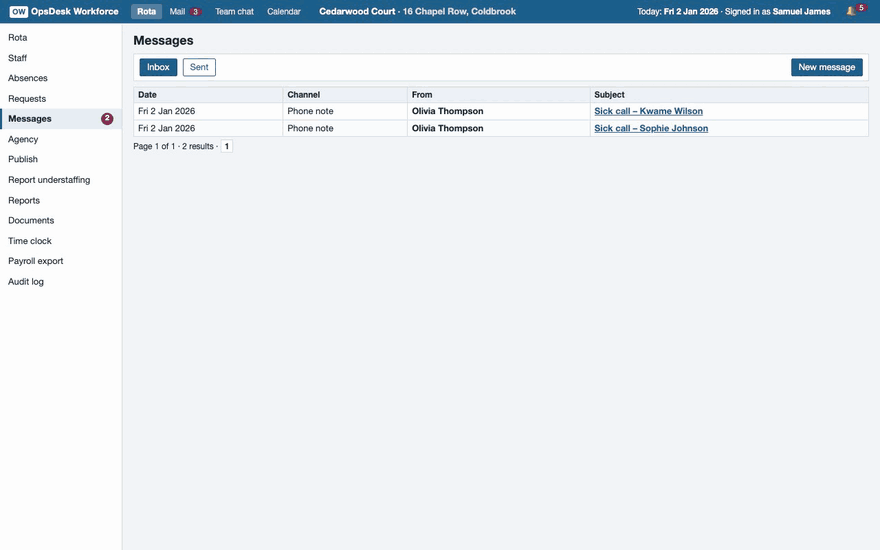

# OpsDesk Workforce – public reviewer sample

OpsDesk Workforce is a self-hosted replica of care-home rota and staffing software (UK and German editions), built as
a verified reinforcement-learning environment for agents. Next to the rota the workspace has a mail client, a team
chat and a calendar on one clock; colleagues answer by fixed rules. Computer-use agents work in the browser, tool-use
agents call the same functions over HTTP or MCP, and both change one shared workspace. A deterministic verifier
scores the final workspace – no LLM judge.

**Custom RL environments that can't be gamed: built in days, proven against reward hacking, difficulty calibrated on real models.**



This repository holds **5 requests with their reference solutions** (public on purpose, so you can score your own
agent), the app image's build context with the runtime and the verifier, and the proof report for exactly these 5
requests. They were generated for this sample from a fresh seed block and are in no sold, training or evaluation set.

| Request | Workflow | Difficulty | Edition | Period | Staff | Reference actions | What the home manager asks |
|---|---|---|---|---|---:|---:|---|
| `ow-658ad870c5a6` | Swap requests | easy | UK | 7 days | 64 | 16 | five shift-swap requests: approve what the rules allow, decline the rest with a reason, tell both people in each request |
| `ow-e47b95f24436` | Sick-call repair | medium | DE | 7 days | 19 | 4 | two sick calls, the first from someone on a night shift: close the gaps with as few changes as possible, a notice to everyone moved |
| `ow-0dcf43a361e2` | Works-council rejection | medium | DE | 7 days | 20 | 6 | the works council sent the draft back: fix its points, resubmit, publish, and cover a shift that was still open |
| `ow-52c93274b5a8` | Agency budget | hard | UK | 14 days | 17 | 13 | sick calls in the messages, extra demand and the agency budget only in the mail: cover within the budget, as cheaply as the rules allow |
| `ow-087ab90a8670` | Period that cannot be fully covered | expert | DE | 14 days | 17 | 18 | a two-week period that cannot be fully covered: cover the legal maximum and report the rest as understaffing, with reasons |

## Run it in 5 minutes

Needs Docker, curl and Python 3. In this folder:

```bash
./quickstart.sh
```

It builds the image `opsdesk-workforce-sample:3.2.0` from `docker/`, starts request `ow-52c93274b5a8`, scores the empty workspace (**0**),
replays the reference solution through the tool API and scores again (**1.0, passed**), then removes the container.
Another request: `./quickstart.sh <request> [port]`. Measured here (Apple M4, macOS 27.0.1, Docker 29.9.2, 2026-11-04): the image built from zero in 14 s (Python base image already downloaded); then each request took about 1 s – empty workspace 0.0, reference 1.0 passed on all 5 (`CHECK.json`).

Your own agent, the browser, MCP and Harbor: [`QUICKSTART.md`](QUICKSTART.md).

## Proven on these 5 requests

| Check | Result |
|---|---|
| Reference solution (API / GUI forms / real browser) | 5/5 · 5/5 · 5/5 score 1.0 |
| Doing nothing | 5/5 score 0 |
| Cheat agents (7 kinds) | 35/35 runs score 0 |
| Near misses (one thing wrong) | 52/52 rejected (highest 0.9550) |
| Equivalent solutions | 51/51 accepted |
| Hack probes | 55/55 passed |

Details, every cheat agent and every near miss: [`PROOF_REPORT.md`](PROOF_REPORT.md) (data in `proofs/`).

## How a frontier model does

| Run | Model | Result |
|---|---|---|
| First 7 of 20 pre-registered Workforce 3.2 requests, one attempt each, tool API | Claude Opus 5.5 | 3 of 7 fully solved |
| Previous release, 10 requests, one attempt each | Claude Opus 5.5 | 1 of 10 fully solved, 4 of 10 accepted |

Where it fails: it leaves shifts open that could be covered, mishandles swap requests, builds rotas a few percent
dearer than needed and forgets to tell everyone whose shift changed. *Fully solved* is `passed: true` (every gate and
a total of at least 0.999); *accepted* means everything is right and the cost is at most 0.5 % above the reference.
The 5 requests in this sample have not been run on a model; the full run with several models follows in November 2026.

## The full environment

| | This sample | OpsDesk Workforce 3.2 |
|---|---|---|
| Verified requests | 5 | 1,000 |
| Request families | 5 | 10, easy to expert |
| Editions | UK, DE | UK, DE |
| Period and staff | 7–14 days, 17–64 staff | 7–30 days, 19–74 staff (301-request evaluation set) |
| Longest reference solution | 18 actions | 452 actions; a long-horizon tier of 36 requests needs 143–452 |
| Reference needs two or more apps | – | 148 of 301 |
| References proven optimal | – | 278 of 301 |
| Cheating agents | 35/35 runs score 0 | 7 kinds score 0 on every request |
| Near misses | 0 of 52 pass | none of 616 reaches 0.995 |
| Equivalent solutions | 51/51 accepted | all 636 score 1.0 |
| No-model greedy script | passes 1 of 5 | passes 23 of 301 |
| Licence | evaluation only | evaluation, training, exclusive on request |

Requests in sold sets come from fresh seed blocks and never appear in a public sample. Care standards and staffing
rules were set or confirmed by a practising head of nursing in long-term residential care (35 years in nursing, 17 as
head of nursing).

## How scoring works

- The verifier judges the **final workspace**, not the transcript: rota, requests, messages, mails, chat posts,
  calendar entries and reports. The same checks run whether the agent used the screens or the tools.
- **Gates (any fail → 0):** a valid result; no working-time or house rule broken and nothing changed that the
  request did not ask for; every shift covered (or the proven maximum where full cover is impossible); the agent's
  own statements in the app are true; no harmful side effects (medical details in group channels, staff data sent
  outside); the workflow's deliverable exists.
- **Then weighted layers:** cost against a solver reference, stability (few changes), a notice to everyone whose
  shift changed, honesty. **Pass = `passed: true`** (every gate and a total of at least 0.999).
- Code: `docker/runtime/opsdesk/verifiers/` and `docker/runtime/opsdesk/workforce/score_workspace.py`.

## In this repository

| Path | What |
|---|---|
| `quickstart.sh`, `QUICKSTART.md` | One-command check; running your own agent |
| `docker/` | Build context of the app image: runtime (app, tool API, MCP, verifier) and the 5 workspaces |
| `data/tasks/`, `data/host_data/` | The 5 workspaces (request text in `task.json` → `instruction`) |
| `data/private/references/` | The reference solutions of these 5 requests (public in this sample only) |
| `formats/` | Harbor (one task per request), HUD (computer use + MCP), OpenEnv, verifiers-style list, HTTP, MCP |
| `PROOF_REPORT.md`, `proofs/` | The proof report for these 5 requests and its data |
| `replay_gold.py` | Replays a request's reference calls against a running app (standard library only) |
| `demo.gif` | The reference solution of `ow-52c93274b5a8`, clicked through the screens (scored 1.0) |
| `CHECK.json` | The quickstart run on all 5 requests, measured |
| `manifest.json`, `SHA256SUMS` | Contents and checksums of every file |

Not in this repository: the task generator and the solver model that computed the references. Evaluation sets
never ship their references (you send the exported workspaces, they are scored with the same verifier); a training
licence seals them into a scoring image.

Licence: **evaluation only** ([`LICENSE.md`](LICENSE.md)) – no training, no redistribution. All homes, people and
records are fictional.

---

Need one for your domain? [getvencur.com](https://getvencur.com) · [info@getvencur.com](mailto:info@getvencur.com)
